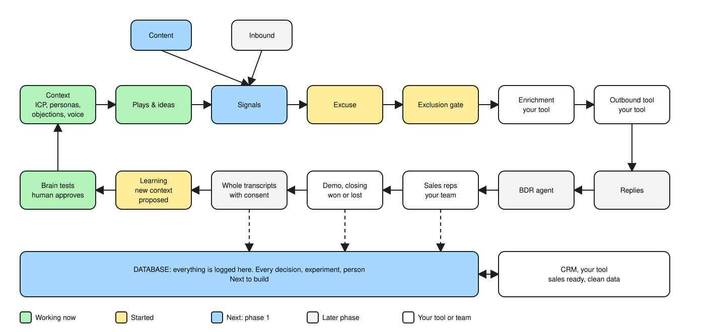

# Gluely

**An open-source GTM brain.** Your agent does the thinking. Gluely keeps the memory, the rules and the learning loop.

Gluely isn't an outbound tool, and it doesn't pick your vendors. Bring any scraper, sequencer, CRM, data store and agent. We can recommend, but we never require. Every GTM motion runs the same loop, so Gluely is the base you build on, and your outcomes keep improving your ICP, personas and messaging.



Green works today, yellow has started, blue is next, grey is a later phase, and white is your own tool or team.

## Try it

```bash
git clone <this-repo> gluely && cd gluely && npm install && npm link

gluely init ../my-brain --company "Acme" --domain acme.example --motion sales_led
cd ../my-brain
gluely doctor     # where you stand and what to do next
gluely flow       # the loop, drawn from your real state
```

Then open your agent in that folder and run `/setup-gluely`. It maps your stack, asks for read-only connections, analyzes your real deals and challenges your ICP before it writes anything.

## How it works

**The brain asks, your agent reasons, the brain validates.** The CLI never calls a model, and it never sends a message.

| Layer | What it is | Who owns it |
|---|---|---|
| Skills | `/setup-gluely`, `/gtm-mode`, playbooks, principles | Open source |
| CLI | Rules, checks and tests. Every command supports `--json` | Open source |
| Brain | `context/`, `plays/`, `tests/` | You, in a private repo |

**Every correction becomes a test.** At startup volume, rates are mostly noise, but corrections aren't. Tell the brain it got something wrong and it keeps the lesson:

```bash
gluely test add --kind reply --input "Who else uses this?" --expect question
gluely test          # compares this context version with the last, and fails on a regression
```

**Keep your stack.** `gluely stack set store Snowflake` works, and so does `gluely stack set store "a spreadsheet"`. See [docs/stack.md](docs/stack.md) for options and [docs/store-contract.md](docs/store-contract.md) for how any data store will plug in.

**Build on it.** Add your own signals in `workspace.yaml`, your own plays in `plays/`, and your own tests in `tests/`, with no change to core.

## Status

Phase 0 of 5: the brain pack.

| Phase | Adds | Status |
|---|---|---|
| 0 | Stack map, onboarding, context, plays, skills, brain tests | Working |
| 1 | The ledger on any store: Person 360, content, imports, read-only MCP | Next |
| 2 | Work queue, excuses linked to signals, opt-outs | Planned |
| 3 | Conversations, BDR drafts, reply-to-demo rate | Planned |
| 4 | CRM, transcripts, won and lost, the full loop | Planned |

## Install the skills only

```text
/plugin marketplace add <this-repo>
/plugin install gluely@gluely
```

## License

MIT
