# Explanation statecharts

These charts explain how Gluely is meant to behave. They are not the CLI, and they are not a game.

Each chart is produced from a TLA+ model:

1. TLC checks the model.
2. `view.ts` names each state and step in reader words.
3. The pstack statechart tool writes `chart.mmd`.
4. [Pele](https://pele.run) 1.9.0 draws `chart.svg`.

No chart is drawn by hand, and no image model is used. The models use no company data and no real person.

**What "the rules hold" means.** TLC checks the model, not the code. A rule holding here shows the design is consistent. It doesn't show the product behaves this way.

| Chart | Status in the product |
|---|---|
| What a reply can teach | Partly built: `learning/log.jsonl`, `gluely recall`, `gluely learn`. Reply labels arrive in phase 3 |
| Gates before a send | Partly built: exclusions and draft checks. Suppression and the check at send time are planned |
| Person 360 | Planned for phase 1 |
| One active play | Planned for phase 2 |

**Every rule can fail.** `node docs/charts/check.mjs` runs in CI. It checks each model, then removes each guard in turn and requires TLC to catch the broken rule. A rule that still holds with its guard gone proves nothing, so the check fails.

A step that stays in the same chart state is not drawn. That is the resting step at the end of each model (`Done` in the spec).

Brackets on an arrow in a side-by-side chart name the other region's state. On the job-switch region, `[when Not asking]` means the hiring region is "Not asking".

## Person 360



A LinkedIn URL arrives and an internal id is minted. The URL is linked onto that id. Signals are appended. Person 360 is filled in from the ledger. Sales-ready fields go to the CRM, and a stage change comes back and goes on the ledger.

TLC reached 15 states. These rules hold:

- The ledger only grows, one event at a time: a signal, a sales-ready mark, then a stage change.
- A signal belongs to an internal id, and a LinkedIn URL sits on that id.
- Person 360 shows a person only after an id exists and an event is logged.
- The CRM is written only after the view shows the person and a sales-ready mark is on the ledger, so a raw pooled list can't reach it.
- A stage change from the CRM always lands on the ledger.

Left out: merges, enrichment, and field ownership beyond this boundary. The sales-ready mark stands for a positive reply, a meeting, or a handoff.

## Gates before a send



A like or a visit is not consent. An exclusion rule or a suppression hash stops the send. After both pass, a person approves the draft. Someone can still opt out or become excluded after that, so the gate is checked again at the moment of the send, and the touch goes out with play, variant, and context.

TLC reached 9 states. These rules hold:

- There is no send while the person is excluded or suppressed, even if a person already approved the draft.
- A send exists only from a clear gate, only after a person approves, and only with play, variant, and context.
- Engagement itself does not approve or send anything.

Left out: volume caps, freshness, and cross-play arbitration.

## One active play



Job-switch and hiring can both want the same person. If only one is asking, it runs. If both are asking, arbitration keeps job-switch and records that hiring stepped aside. A later signal for the other play is set aside too.

TLC reached 8 states. These rules hold:

- The two plays are never both the active play.
- Stepping aside happens only while the other play is the active one, so the loss is recorded.

Left out: cooldown days, the account cap, and ties broken by signal strength. In this model job-switch outranks hiring.

## What a reply can teach



Every reply label can teach, and so can a person changing a draft. An unsubscribe also suppresses the person. The agent writes the lesson, and Gluely refuses it if it holds an email or a LinkedIn address. Open lessons are read by `gluely recall`. A rule proposed from a lesson is either approved by a person and promoted, or dropped with a reason.

TLC reached 36 states. These rules hold:

- The log never keeps a lesson that holds personal data.
- Each lesson comes from a real reply or edit.
- Only a person promotes a lesson.
- An unsubscribe always suppresses, and nothing else does.
- Positive, not now, negative, unsubscribe and human edits can each become a promoted lesson.

Gluely's check catches emails and LinkedIn addresses. Keeping out a prospect's other words is a rule the agent follows, not something Gluely can enforce.

Left out: the other reply labels, transcripts, and the minimum sample of sends.

## Regenerate

Needs Java 11 or later, Node 22.18 or later, and the pstack `statechart` script (`skills/statechart/scripts/statechart`). Run `check.mjs` after changing a model, and add a break for any new rule.

From the repo root:

```bash
bash docs/charts/regenerate.sh
```

The script downloads TLC 1.7.4 when it is missing, checks sha256 `936a262061c914694dfd669a543be24573c45d5aa0ff20a8b96b23d01e050e88`, runs statechart for each spec, and renders the SVG. Point it at a particular checkout of the script with `STATECHART`:

```bash
export STATECHART=/path/to/skills/statechart/scripts/statechart
export TLA2TOOLS="$HOME/.cache/statechart/tla2tools.jar"   # optional
export JAVA=java                                            # optional
bash docs/charts/regenerate.sh
```

One chart, the same steps the script runs for Person 360:

```bash
export TLA2TOOLS="$HOME/.cache/statechart/tla2tools.jar"
export JAVA=java
out=$(mktemp -d)
"$STATECHART" docs/charts/person-360/Person360.tla \
  --view docs/charts/person-360/view.ts \
  --out "$out"
cp "$out/chart.mmd" docs/charts/person-360/chart.mmd
node docs/charts/render-svg.mjs docs/charts/person-360/chart.mmd docs/charts/person-360/chart.svg
```

The other three specs are `docs/charts/send-gates/SendGates.tla`, `docs/charts/play-arbitration/PlayArbitration.tla`, and `docs/charts/learn-loop/LearnLoop.tla`. Each has a `view.ts` beside it. The config file is the `.cfg` with the same name as the module.

`render-svg.mjs` installs `pele@1.9.0` under `~/.cache/statechart/pele` and renders with `{ limit: 1000000, outputLimit: 8000000, maxEdges: 10000 }`.

`statechart` prints TLC's report and does not write it into this folder. Exit 0 means every rule held.
